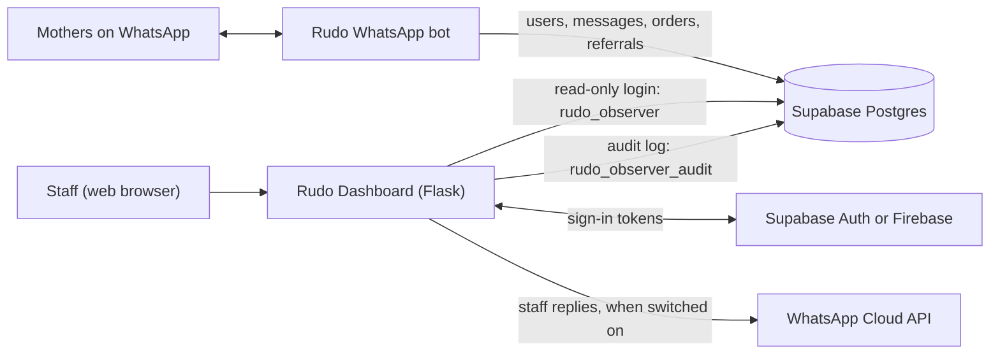

# Rudo Dashboard: the staff dashboard for Dawa Health's WhatsApp assistant

[](LICENSE)

Rudo is the WhatsApp assistant from [Dawa Health](https://dawa-health.com/) that answers mothers' questions about pregnancy and cervical cancer, and takes orders for Dawa Health products. This repository is the web dashboard Dawa Health staff use to follow that work: they read Rudo's conversations, orders and referrals, see usage figures, and can reply to a mother from Rudo's WhatsApp number. Administrators also use it to invite staff, approve sign-ins and decide which facilities each person can see.

The dashboard reads the same Supabase database the WhatsApp bot writes to, through a read-only database login. It does not change the bot's data, apart from staff replies (see [How it was built](#how-it-was-built)).

> The dashboard supports staff work. It is not a medical device and does not replace professional clinical judgment. See [Clinical safety](#clinical-safety).

## Contents

1. [What it does](#what-it-does)
2. [How it works](#how-it-works)
3. [How it was built](#how-it-was-built)
4. [Tech stack](#tech-stack)
5. [Getting started](#getting-started)
6. [Configuration](#configuration)
7. [Repository layout](#repository-layout)
8. [Database migrations](#database-migrations)
9. [Testing](#testing)
10. [Deployment](#deployment)
11. [Clinical safety](#clinical-safety)
12. [Data protection](#data-protection)
13. [Troubleshooting](#troubleshooting)
14. [Contributing](#contributing)
15. [License](#license)

## What it does

- **Conversations.** Browse mothers' WhatsApp conversations with Rudo and open the captured history of each one.
- **Orders and referrals.** See product orders taken by the bot, and where each mother heard about Rudo (clinic posters, flyers and so on).
- **Analytics.** Counts of users, conversations, messages, orders and referrals for the facilities you can see.
- **Staff replies.** Operators and admins can answer a mother from Rudo's WhatsApp number. The reply is saved with the conversation, so the bot sees it as context in later answers. This is off unless it is switched on (`RUDO_ENABLE_STAFF_REPLIES`).
- **Staff management.** Administrators invite staff, approve or dismiss pending sign-ins, change roles and facility access, suspend accounts, and see recent administrative activity.
- **Sign-in.** Staff sign in with Supabase Auth or Firebase Authentication, depending on configuration.

### Staff roles

| Role | Can see and do |
|---|---|
| Analyst | Analytics only |
| Operator | Conversations, orders, referrals and analytics, and replies to mothers |
| Admin | Everything an operator can, plus staff management |

Every role is limited to the facilities the staff member is assigned.

## How it works



### What happens when a staff member opens a conversation

1. The browser signs the staff member in with Supabase Auth or Firebase and sends the token with each request.
2. The server checks the token, looks up the staff member's role and facilities, and refuses the request if the account is suspended or not yet approved.
3. The server reads only the rows that staff member is allowed to see, using the read-only `rudo_observer` login.
4. The access is written to the audit log through a separate login, `rudo_observer_audit`.
5. The page shows the captured history. Messages the bot doesn't store, such as its fixed greetings and shop menus, are missing, and the page says the history may be incomplete.

## How it was built

The main design decisions, and why they were made.

### 1. A read-only dashboard over the bot's own tables

The original dashboard read the bot's data from Upstash Redis and called the WhatsApp API from the browser. The bot now keeps its data in Supabase, so the dashboard reads those tables directly instead of keeping its own copy. It connects as `rudo_observer`, a login that can only `SELECT` the columns it needs from `users`, `messages`, `orders` and `referrals`, through row-level security policies made for it. It has no access to the bot's working tables (`kv`, `user_state`), and the bot's own permissions are unchanged.

### 2. Staff control lives in its own schema

Staff, roles, facility access, invitations, sign-in links and the audit log are kept in the `observer_control` schema. That schema is not exposed through Supabase's public Data API, and the `anon`, `authenticated` and `service_role` roles have no access to it. Administrative changes go through the server, never directly from the browser.

### 3. Facility scope

Each staff member is limited to the facilities they are assigned. A mother's facility comes from where she was referred, for example a poster at a particular clinic. The rules that match referral text to a facility are in `deploy/facility_rules.json`, and the owner applies them with `scripts/staff_admin.py map-referrals`. Only mothers whose referrals match exactly one facility are mapped.

### 4. Staff replies without breaking the bot

A reply is sent from Rudo's WhatsApp number by the dashboard server. Two database functions wrap each send: `begin_staff_reply()` refuses to send while a human agent is already chatting with that mother, and `finish_staff_reply()` saves the confirmed reply in `public.messages` as a bot message, exactly as the bot stores its own replies. Replies are off by default and need their own database login (`RUDO_SENDER_DATABASE_URL`).

### 5. Moving staff sign-in from Firebase to Supabase

Staff used to sign in with Firebase. The server can now check Firebase tokens, Supabase tokens, or both at once during the move (`RUDO_IDENTITY_PROVIDERS`), and each staff member's existing role and facilities follow them to their new sign-in. The scripts in `scripts/` take an inventory of Firebase accounts, import them, and record the outcome of each one. Firestore data can be landed in a separate, private schema without touching Rudo's own tables.

### 6. Safe by default

- Remote databases are refused unless `RUDO_OBSERVER_ALLOW_REMOTE=true`, and then only with verified TLS (`sslmode=verify-full`).
- The server refuses to start if a Supabase secret or service-role key is set where a browser-safe key belongs.
- Web access logs are off, because URLs can carry references derived from phone numbers.
- Test and demo tools only run against a marked, disposable local database, and refuse anything else.
- `scripts/check_secrets.py` scans the code for keys before you commit.

### 7. Legacy pages

The pages from the original dashboard (`index.html`, `chats.html`, `analytics.html`, `orders.html` and others) are still in the repository and used by regression tests of the older "private" mode. The production image serves only the observer, staff and sign-in pages (see the `Dockerfile`).

## Tech stack

- Python 3.12, Flask, Gunicorn
- PostgreSQL 17 on Supabase, accessed with psycopg 3 and row-level security
- Supabase Auth and Firebase Authentication (`firebase-admin`) for staff sign-in
- Plain HTML, CSS and JavaScript in the browser, with Chart.js for charts
- WhatsApp Cloud API for staff replies
- Docker for deployment

## Getting started

### Prerequisites

- Python 3.12
- PostgreSQL 17 for the local test database. On a Mac: `brew install postgresql@17`
- Node.js and Google Chrome, only for the browser tests

### 1. Get the code and install dependencies

```sh
git clone https://github.com/Dawa-Health/ai_agent_dashboard.git
cd ai_agent_dashboard
python3.12 -m venv .venv
.venv/bin/pip install --require-hashes -r requirements-dev.txt
```

The requirements files pin every package with a hash. To change a dependency, edit `requirements.in` or `requirements-dev.in` and regenerate the `.txt` file with `uv pip compile ... --generate-hashes`.

### 2. Try the synthetic demo (Mac, no passwords needed)

```sh
scripts/demo_mac.sh
```

Then open http://127.0.0.1:5051/observer.html. Stop it with Control+C. The demo starts a throwaway PostgreSQL database, fills it with made-up mothers, conversations, orders, referrals and staff, and deletes it when you stop. It never connects to Supabase, Firebase or WhatsApp, and "sending" a reply is a local stand-in. It ignores your shell settings and `.env`, so real credentials are never used.

### 3. Run the demo step by step (optional)

```sh
scripts/start_test_database.sh
.venv/bin/python scripts/bootstrap_observer.py
.venv/bin/python scripts/run_observer_demo.py
```

Running the tests or the bootstrap resets the synthetic schemas, so stop the demo first.

### 4. Run against a real Supabase project

Copy `.env.example` to `.env` (it is gitignored), fill in the values, and run:

```sh
.venv/bin/python scripts/run_dashboard_local.py
```

This serves the production dashboard on http://localhost:8080 with Supabase sign-in. The browser only ever receives the Supabase URL and the publishable key.

## Configuration

All settings come from environment variables. `.env.example` lists every name with a short explanation and contains no values. In production, set them in your hosting platform's secret settings, not in a file.

| Setting | What it does |
|---|---|
| `RUDO_MODE` | `observer` (the default and the only production mode). `private` is the legacy mode, used only by its tests. |
| `RUDO_OBSERVER_DATABASE_URL` | The read-only `rudo_observer` login |
| `RUDO_OBSERVER_AUDIT_DATABASE_URL` | The separate audit-log login |
| `RUDO_STAFF_ADMIN_DATABASE_URL` | The login used by the staff management page |
| `RUDO_SENDER_DATABASE_URL` | The login used to record staff replies |
| `RUDO_OBSERVER_ALLOW_REMOTE` | Must be `true` to use a remote database. Remote links must use `sslmode=verify-full`. |
| `RUDO_IDENTITY_PROVIDERS` | Which sign-in tokens the server accepts: `firebase`, `supabase`, or `firebase,supabase` |
| `RUDO_BROWSER_AUTH` | Which sign-in pages the browser uses: `firebase` or `supabase` |
| `SUPABASE_URL`, `SUPABASE_ANON_KEY` | Browser-safe Supabase values. The key must be a publishable or anon key. |
| `RUDO_SUPABASE_SESSION_CHECK` | Checks with Supabase Auth on each request that the session still exists. Keep `true`. |
| `RUDO_CURSOR_SECRET` | 32 or more random characters, the same on every server instance. Signs pagination links. |
| `RUDO_ENABLE_STAFF_REPLIES` | Switches staff replies on. Also needs the WhatsApp settings below. |
| `WHATSAPP_TOKEN`, `WHATSAPP_PHONE_NUMBER_ID`, `WHATSAPP_API_VERSION` | WhatsApp Cloud API settings for staff replies |
| `RUDO_ALLOWED_ORIGIN` | The web address the dashboard is served from |
| `RUDO_TRUST_PROXY` | `true` only behind your hosting platform's TLS load balancer |

`SUPABASE_SERVICE_ROLE_KEY` and the Firebase migration settings are used only by the owner scripts in `scripts/`, never by the web app. Run `.venv/bin/python scripts/check_env.py` to check a configuration.

## Repository layout

```
.
├── app.py                 # Flask app: creates the app and picks the mode
├── wsgi.py                # Entry point for Gunicorn
├── rudo/
│   ├── observer.py        # Read-only queries, staff identity, facility scope
│   ├── observer_api.py    # Web API for the observer, staff and health pages
│   ├── auth.py            # Firebase and Supabase token checks
│   ├── replies.py         # Staff replies through WhatsApp
│   ├── staff_migration.py, firebase_migration.py, firestore_migration.py
│   │                      # Moving staff and data from Firebase
│   ├── synthetic.py       # Made-up data for tests and the demo
│   └── db.py, delivery.py, importer.py, errors.py   # Legacy private mode and shared helpers
├── observer.html          # Conversations, orders, referrals and analytics
├── staff.html             # Staff management
├── staff-login.html, staff-reset.html, login.html, ...   # Sign-in pages
├── css/, js/, img/, fonts/
├── supabase/
│   ├── migrations/        # Versioned database changes
│   ├── rollback/          # Matching undo scripts
│   └── config.toml        # Local Supabase settings
├── deploy/
│   ├── gunicorn.conf.py   # Web server settings
│   ├── facility_rules.json
│   ├── certs/             # Supabase's public CA certificate
│   └── release/           # Checks to run before and after a release
├── scripts/               # Demo, tests, backups, staff admin and migration tools
├── tests/                 # pytest suite
├── Dockerfile
└── .env.example           # Setting names only
```

## Database migrations

| Migration | What it does |
|---|---|
| `20261121120000_rudo_staff_control.sql` | Creates the `observer_control` schema, the dashboard's database logins, and read-only policies on `users`, `messages`, `orders` and `referrals` |
| `20261121150000_rudo_staff_replies.sql` | Adds `begin_staff_reply()` and `finish_staff_reply()` for staff replies |
| `20261123063840_firebase_account_migration.sql` | A private ledger of every Firebase account and the outcome of its move |
| `20261123085525_firebase_data_landing.sql` | A private schema that holds Firestore documents, separate from Rudo's tables |

Each migration runs in one transaction, and each has an undo script in `supabase/rollback/`. The header of each file says what it changes and whether it needs the owner's approval before it is applied to production. Database passwords are set separately at release time and never appear in these files.

Before changing production, take an encrypted backup with `scripts/backup_production.sh`. `deploy/release/` holds read-only checks to run before (`precheck.sql`) and after (`postcheck.sql`) applying a migration, plus the Firebase equivalents.

To apply the migrations to the local test database:

```sh
.venv/bin/python scripts/apply_local_migrations.py
```

## Testing

Run the whole suite, including the database and browser tests:

```sh
scripts/test_local.sh
```

It starts a temporary PostgreSQL 17 database on `127.0.0.1:55439` (or reuses the test database if it's already running), runs pytest with coverage, and deletes any database it started. If PostgreSQL is not installed in Homebrew's usual place, set `RUDO_TEST_PGBIN` to its `bin` folder.

| Kind of test | Needs |
|---|---|
| Unit and API tests | Nothing extra |
| Database tests | The temporary test database |
| Browser tests (`test_*browser*.py`) | The test database, Node.js and Chrome |

The test tools check that the database is the marked, disposable test cluster before resetting anything, so they cannot be pointed at real data.

The GitHub workflow in `.github/workflows/test.yml` runs pytest on every push but does not yet start the test database, so the database and browser tests fail there. Run `scripts/test_local.sh` before you open a pull request.

## Deployment

The `Dockerfile` builds a small image that runs the dashboard with Gunicorn as a non-root user on port 8080.

- The image contains only what the dashboard needs. Tests, scripts, fixtures and local files stay out.
- Packages are installed with `--require-hashes`.
- Health checks: `/healthz` says the server is up, and `/readyz` says it can reach the database with its restricted logins.
- To connect to Supabase with verified TLS, put Supabase's public CA certificate in `deploy/certs/prod-supabase.crt`. See `deploy/certs/README.md`.
- Set every setting in the hosting platform's secret settings. No secrets go into the image.

## Clinical safety

- The dashboard shows what the bot captured. It may miss some WhatsApp interactions, and delivery status is not always known. Check with the mother when it matters.
- Rudo's triage logic is not changed by this dashboard.
- A staff reply is sent from Rudo's number and becomes part of the conversation the bot sees. Staff are responsible for what they send.
- If a conversation shows signs of an emergency, follow your facility's emergency procedures. Do not rely on the chat.

## Data protection

Conversations contain health information about mothers. The dashboard:

- reads only the columns it needs, through a read-only login and row-level security
- limits each staff member to their facilities, and records access in an audit log
- keeps staff administration in a schema that the public Supabase API cannot reach
- refuses unencrypted connections to remote databases
- keeps web access logs off, because URLs can carry phone-derived references
- uses only made-up data in tests and the demo

Never commit real patient data, database links with passwords, tokens or keys. `.env` is gitignored. Run `.venv/bin/python scripts/check_secrets.py` before every commit.

## Troubleshooting

- **`connection to server at "127.0.0.1", port 55439 failed`:** the test database is not running. Use `scripts/test_local.sh`, or start it with `scripts/start_test_database.sh`.
- **`initdb: command not found` or a PostgreSQL path error:** install PostgreSQL 17, or set `RUDO_TEST_PGBIN` to the folder that contains `initdb` and `pg_ctl`.
- **The server refuses a remote database:** set `RUDO_OBSERVER_ALLOW_REMOTE=true` and add `sslmode=verify-full` to the database link.
- **The server will not start because of the Supabase key:** `SUPABASE_ANON_KEY` must be a publishable or anon key, never the service-role key.
- **Staff can sign in but see nothing:** an administrator still has to approve them, or give them access to a facility, on the Staff page.
- **A reply is refused:** a human agent may be chatting with that mother on WhatsApp, or staff replies are switched off.

## Contributing

See [CONTRIBUTING.md](CONTRIBUTING.md) and the [Code of Conduct](CODE_OF_CONDUCT.md). Before you open a pull request:

1. Run `scripts/test_local.sh` and make sure everything passes.
2. Run `.venv/bin/python scripts/check_secrets.py`.
3. Put any database change in a new migration in `supabase/migrations/`, with an undo script in `supabase/rollback/`.

## License

[GNU Affero General Public License v3.0](LICENSE).
